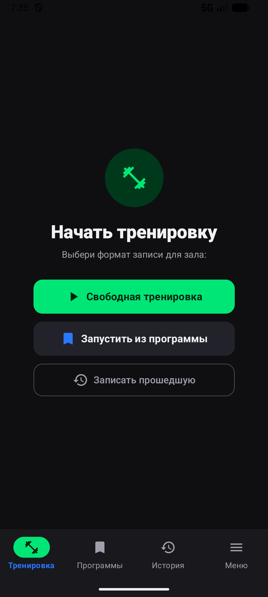
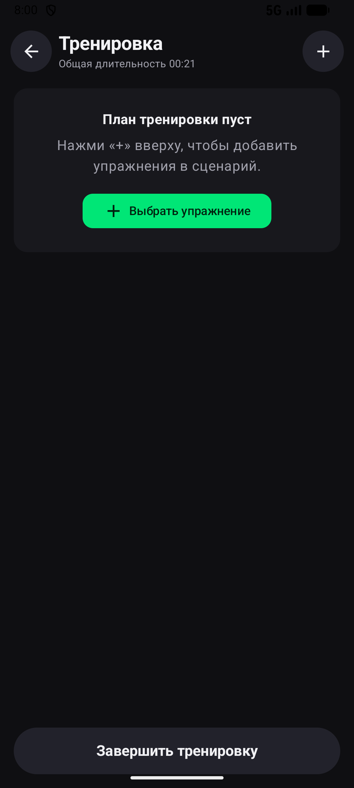
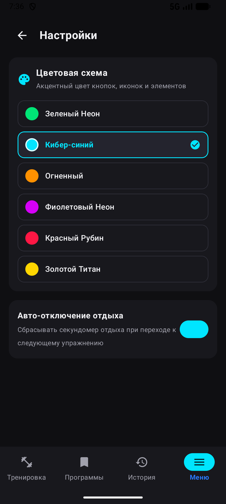
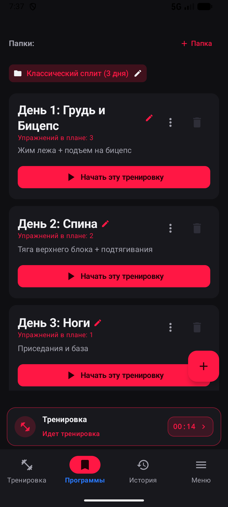
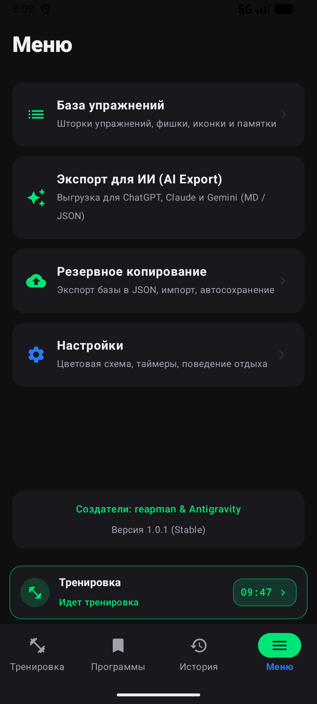

<div align="center">

# 🏋️‍♂️ GymHelper

**Современный, ультрабыстрый и надежный трекер силовых тренировок для зала**  
*Создан спортсменами для спортсменов. Чистый оффлайн, AMOLED Dark тема, мгновенный учет подходов и максимальная защита данных.*

<br/>

[](https://github.com/ReapMan/gymhelper/releases)
[](https://github.com/ReapMan/gymhelper)
[](https://developer.android.com/jetpack/compose)
[](https://www.sqlite.org/wal.html)
[](LICENSE)
[](https://github.com/ReapMan)

<br/>

[-00E676?style=for-the-badge&logo=android&logoColor=black)](https://github.com/ReapMan/gymhelper/raw/main/GymHelper-v1.0.1-reapman.apk)

</div>

---

## 📸 Скриншоты интерфейса

<div align="center">
  <table>
    <tr>
      <td align="center"><b>Главный экран</b></td>
      <td align="center"><b>Сценарий тренировки</b></td>
      <td align="center"><b>Цветовые схемы</b></td>
      <td align="center"><b>Фоновый баннер</b></td>
      <td align="center"><b>Меню и бэкапы</b></td>
    </tr>
    <tr>
      <td align="center"></td>
      <td align="center"></td>
      <td align="center"></td>
      <td align="center"></td>
      <td align="center"></td>
    </tr>
  </table>
</div>

---

## ⚡ Ключевые возможности

### 🎨 Кастомизация и AMOLED Dark дизайн
- **Чистый глубокий черный фон (`#0F0F12`)** — максимальная контрастность и экономия заряда батареи на OLED/AMOLED экранах во время долгих тренировок.
- **6 спортивных неоновых тем оформления:**
  - 🟢 **Зеленый Неон** (Cyber Green — классика)
  - 🔵 **Кибер-синий** (Ice Cyan)
  - 🟠 **Огненный** (Flame Amber)
  - 🟣 **Фиолетовый Неон** (Electric Purple)
  - 🔴 **Красный Рубин** (Crimson Fury)
  - 🟡 **Золотой Титан** (Titanium Gold)
- Мгновенное переключение тем оформления во всем приложении в один клик.

### 🏋️‍♂️ Управление тренировочным процессом
- **Свободная тренировка** или **Запуск по готовой программе** из папок сплитов.
- **Интерактивный сценарий:** добавление, замена и перестановка упражнений на лету.
- **Компактный фоновый виджет:** при переходе в историю или программы внизу появляется аккуратный горизонтальный баннер с моноширинным секундомером и кнопкой быстрого возврата в зал.
- **Типы подходов:** разминка, рабочие, дропсеты, работа до отказа и негативные повторения.
- **Интеллектуальный автоподхват:** подсказка рабочего веса и повторений из предыдущего подхода.

### 🛡️ Промышленная надежность данных
- **SQLite в WAL-режиме (Write-Ahead Logging):** высокая скорость записи и нулевой риск повреждения базы данных.
- **Crash Recovery:** при внезапной перезагрузке смартфона или разряде аккумулятора таймер и все подходы восстанавливаются с точностью до секунды.
- **Автобэкап после тренировки:** автоматическое сохранение резервной копии `gym_backup_auto.json`.
- **Полный Snapshot Backup & Restore:** экспорт всей базы тренировок, программ и справочников в JSON для мгновенного переноса на любой другой телефон.

### 🤖 Экспорт для ИИ (AI Data Export)
- Выгрузка тренировочных объемов и истории в структурированном виде **Markdown** и **JSON**.
- Готовые промпты для глубокого анализа периодизации, прогрессивной перегрузки и восстановления в **ChatGPT**, **Claude** и **Gemini**.

---

## 📲 Скачать и установить

| Версия | Ссылка | Размер | Описание |
| :--- | :--- | :--- | :--- |
| **v1.0.1 (Latest)** | [**Скачать APK**](https://github.com/ReapMan/gymhelper/raw/main/GymHelper-v1.0.1-reapman.apk) | `14.4 МБ` | Темы оформления, горизонтальный виджет, UI-полировка |
| **v1.0.0** | [**Скачать APK**](https://github.com/ReapMan/gymhelper/raw/main/GymHelper-v1.0.0-reapman.apk) | `14.4 МБ` | Первый стабильный релиз |

### 💡 Как установить или обновить:
1. Скачайте файл `GymHelper-v1.0.1-reapman.apk` на Android-смартфон.
2. Откройте скачанный файл и подтвердите установку (если потребуется, разрешите браузеру установку неизвестных приложений).
3. **Обновление без потери данных:** если у вас уже установлена версия `1.0.0`, новая версия установится поверх нее, сохранив всю базу и историю тренировок.

---

## 🛠 Технологический стек

- **Язык разработки:** Kotlin 2.2.10
- **UI Toolkit:** Jetpack Compose (Material Design 3)
- **Архитектура:** MVVM (Model-View-ViewModel) + Kotlin Coroutines & StateFlow
- **База данных:** SQLite 3 (WAL mode, Foreign Keys enforcement)
- **Сборка:** Gradle 8.x + Android Gradle Plugin 8.9.x
- **Совместимость:** Android 7.0 (Nougat, API 24) и новее

---

## 🏗 Сборка из исходников

```bash
# Клонирование репозитория
git clone https://github.com/ReapMan/gymhelper.git
cd gymhelper

# Сборка релизного APK
./gradlew assembleRelease
```
Собранный APK появится в папке `app/build/outputs/apk/release/`.

---

## 👤 Создатель

Разработано: **[reapman](https://github.com/ReapMan)**  
Лицензия: [MIT License](LICENSE)  
GymHelper — твой персональный напарник в зале.
